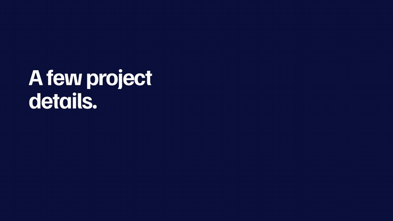
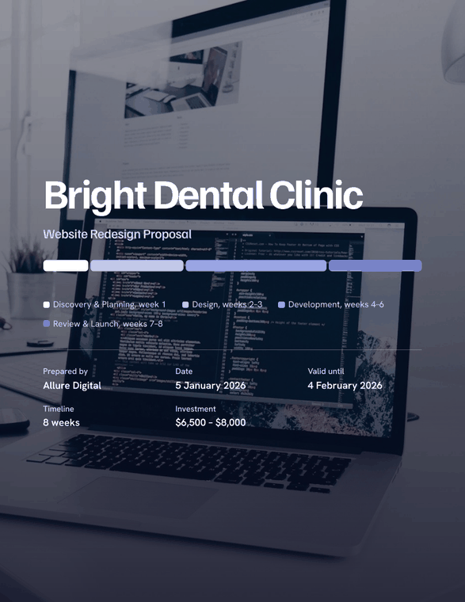

# Client Proposal & Scope Document Generator

Turn a few project details into a finished client proposal: executive summary, scope of work,
timeline and pricing. Edit every word live, then export to HTML, Word or PDF.
It needs no API key and no internet to generate a proposal.

[](docs/assets/demo.mp4)

*Click the preview to watch the 24-second demo video ([`docs/assets/demo.mp4`](docs/assets/demo.mp4)).*

## What you get

The proposal is one modern HTML page, not a paper document:

- **A photo cover.** A relevant photo is chosen automatically from the project type (website, app, marketing, branding or
  general). The client name sits on it at poster size, with the project's phases drawn as a band.
- **An opening quote.** A real, sourced quote with the person's name, chosen by project type. You can switch it off in the
  *Edit content* tab.
- **A sticky navigation bar** that always shows where you are, with a thin progress line.
- **Full-width sections:** executive summary, scope of work (included, not included, assumptions), a timeline drawn as
  bars, a dark *Investment* section with the total as the largest figure, terms, and an *Accept and next steps* section
  with signature fields.
- **Light and dark themes**, a phone layout, and gentle scroll animation (switched off if you prefer reduced motion).
- **One section per page** when printed or saved as PDF, with the colour running to the paper edge.



[`docs/sample-proposal.html`](docs/sample-proposal.html) is a real export. Download it and open it in a browser.

## Run it

You need Python 3.11 or newer.

```bash
python -m venv .venv
.venv\Scripts\python.exe -m pip install -r requirements.txt
.venv\Scripts\python.exe -m streamlit run app.py
```

On Mac or Linux, use `.venv/bin/pip` and `.venv/bin/python` in place of the `.venv\Scripts\` paths.

The app opens at http://localhost:8501 empty, ready for your details. Press *Load sample* in the sidebar
to see a finished proposal straight away. The page loads its fonts and its animation script from the internet when
online; offline it falls back to system fonts and shows the page without animation.

## How to use it

1. **Pick a sample** in the sidebar and press *Load sample*, or type your own details.
   Use *Form fields* for separate boxes, or *Free-form text* with lines like this:
   ```
   Client: Acme Co
   Project type: Website
   Goals: more leads; a faster site
   Deliverables:
   - 5-page website
   - Contact form
   Timeline: 6 weeks
   Pricing: $4k - $6k
   Notes: Launch before March
   ```
2. Press **Generate proposal**.
3. **Edit live.** Change any text in *Edit content*, or change milestones and prices in *Timeline & pricing*.
   The preview, the timeline chart and the totals update as you type.
4. You can also **click straight into the preview** and type over the text. Those edits stay in the preview,
   so use the preview's own *Download HTML* button to keep them.
5. **Export** from the *Export* tab as HTML, Word (.docx) or PDF.

Pressing *Generate proposal* again replaces your edits with a fresh draft.

## What it writes

| Section | Built from |
|---|---|
| Opening quote | A sourced quote chosen by project type |
| Executive summary | Client, goals, deliverables, timeline and phases |
| Scope of work | Your deliverables, plus standard inclusions, exclusions and assumptions for the project type |
| Timeline and milestones | Phases sized to your timeline, for websites, apps, marketing, branding or general projects |
| Investment | Your price or range split across the phases, with each phase's share drawn as a bar |
| Terms and Accept | Payment terms, your notes, next steps and signature fields |

The text is template based, so read it and adjust it before it goes to a client.

### How the photo and the quote are chosen

The app reads the *Project type* and sorts it into one of five kinds (web, app, marketing, brand, general) with the same
keyword matching it uses for timelines and prices. Each kind has one photo (`proposal/assets/hero/`) and a short list of
quotes (`proposal/quotes.py`). The photo is embedded in the HTML, so an exported file works offline and in email.
To change a photo, replace the file of the same name. Photo credits are in
[`proposal/assets/hero/CREDITS.md`](proposal/assets/hero/CREDITS.md). Only add quotes whose wording and source you have
verified.

## Exporting

| Format | How |
|---|---|
| HTML | Download from the *Export* tab. A single self-contained file you can email or host. |
| Word | Download the .docx from the *Export* tab. Fully editable. |
| PDF | Press *Create PDF*. It uses Chrome or Edge already on your computer and takes a few seconds. With neither installed, open the HTML and use Print, then Save as PDF. |

## Samples

Three demos live in `samples/`: a website redesign, a mobile app and a marketing campaign.
To add your own, drop another `.json` file in that folder with the same fields.

## Project layout

```
app.py                   Streamlit interface and live-editing state
proposal/generator.py    Parsing, phase and price templates, proposal builder
proposal/render.py       HTML rendering
proposal/imagery.py      Chooses the cover photo from the project type
proposal/quotes.py       The sourced opening quotes
proposal/docx_export.py  Word export
proposal/pdf_export.py   PDF export through headless Chrome or Edge
proposal/limits.py       Input limits, validation and rate limiting
proposal/monitoring.py   Logging, error tracking (Sentry, optional) and timing
proposal/health.py       Self-check: python -m proposal.health
templates/               The HTML proposal template
samples/                 Demo inputs
tests/                   Test suite
docs/                    README images, the demo video and a sample export
DESIGN.md, PRODUCT.md    The design system and the product notes behind the look
```

## Development

Install the exact pinned versions, then run the same checks that CI runs on every push
(lint, format, types, tests with a coverage minimum, a health check and a dependency vulnerability scan):

```bash
.venv\Scripts\python.exe -m pip install -r requirements.txt -r requirements-dev.txt
.venv\Scripts\python.exe -m ruff check .
.venv\Scripts\python.exe -m ruff format --check .
.venv\Scripts\python.exe -m mypy
.venv\Scripts\python.exe -m pytest --cov
```

To change or upgrade a package, edit `requirements.in` (or `requirements-dev.in`), then rebuild the pinned files:

```bash
.venv\Scripts\python.exe -m piptools compile --strip-extras --no-header --annotation-style=line -o requirements.txt requirements.in
```

## Limits

Text length, the number of list lines, table rows, weeks (104) and amounts (1,000,000,000) are limited, and
"Generate proposal" and "Create PDF" have a short wait between clicks. All numbers are in `proposal/limits.py`.

## Logging, errors and health

Settings are environment variables (see `.env.example`): `LOG_LEVEL`, `LOG_FORMAT` (`text` or `json`),
`LOG_FILE` (default `logs/app.log`, rotates at 1 MB) and `SENTRY_DSN` (optional crash reports; needs `sentry-sdk`).
Logs hold counts and timings only, never client names or prices.
When something unexpected fails, the user sees an *error id*. Search the log or Sentry for that id.

Health check (exit code 0 = healthy): `python -m proposal.health`. The Streamlit server also answers `/_stcore/health`.

## Safe by design

Everything you type is escaped in the HTML output, so pasted markup cannot run as code. A test covers this.
The motion script is an enhancement only: nothing is hidden by CSS, so the page reads fully with no script, offline,
in print and in the PDF.

## Credits

- Cover photos: free-to-use photos from [Unsplash](https://unsplash.com/license) (see the credits file above).
- Demo video: made with [HyperFrames](https://hyperframes.studio) from real renders of the app. Music: Sascha Ende,
  [ende.app](https://ende.app/en) (CC BY 4.0).
